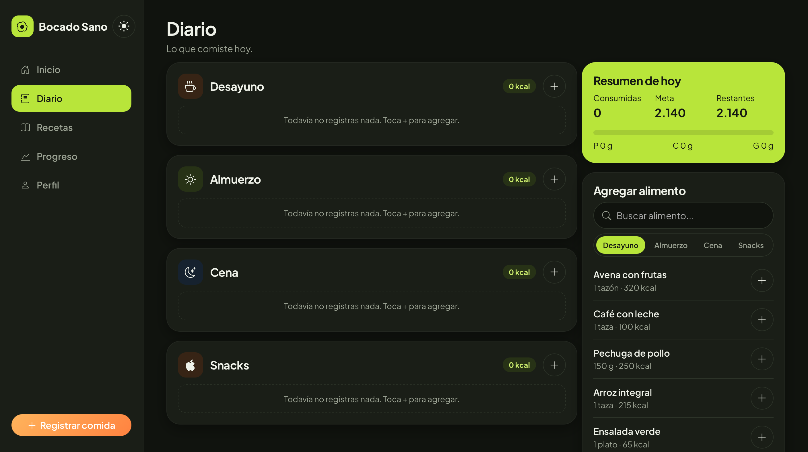
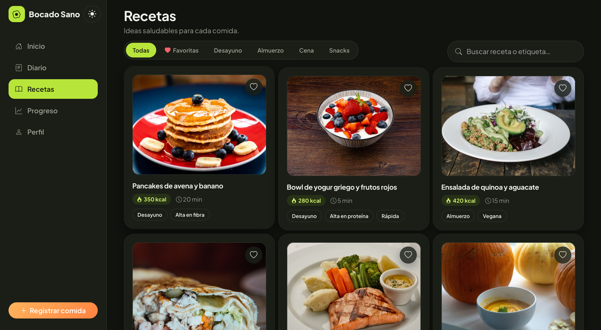
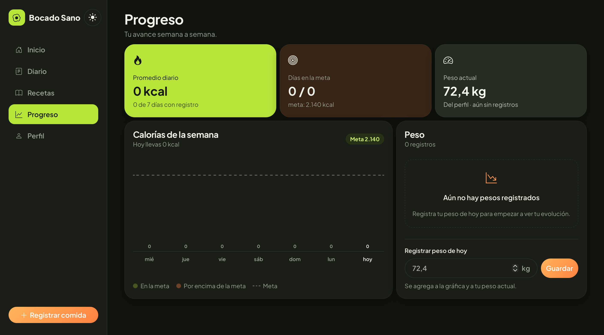
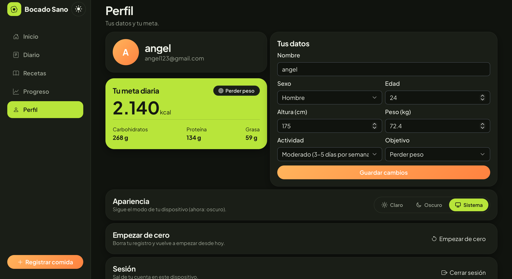
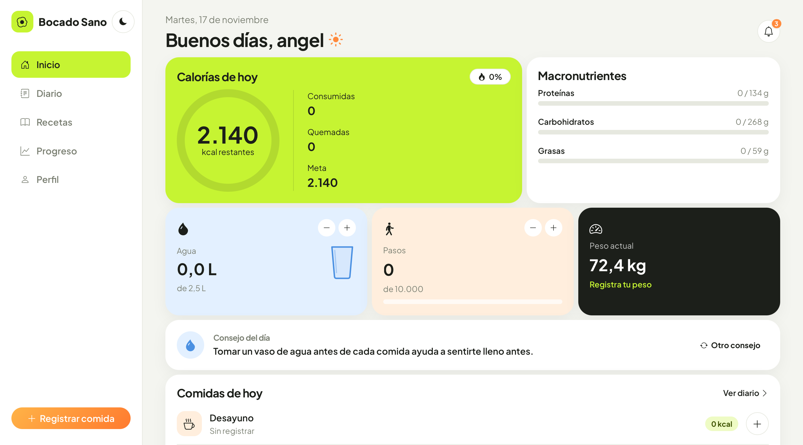

<p align="center">
  
</p>

<h1 align="center">Bocado Sano</h1>

<p align="center">
  App web para llevar una alimentación saludable: registra tus comidas, agua y pasos,<br />
  sigue tu progreso semanal y descubre recetas sanas.
</p>

<p align="center">
  Proyecto final · <strong>Frameworks Frontend con TypeScript</strong> · Angular 22
</p>

---

## Tabla de contenido

- [Descripción](#descripción)
- [Funcionalidades](#funcionalidades)
- [Capturas](#capturas)
- [Vídeo de demostración](#vídeo-de-demostración)
- [Tecnologías](#tecnologías)
- [Cómo ejecutar el proyecto](#cómo-ejecutar-el-proyecto)
- [Estructura del proyecto](#estructura-del-proyecto)
- [Conceptos de Angular aplicados](#conceptos-de-angular-aplicados)
- [Manejo de la información (sin backend)](#manejo-de-la-información-sin-backend)
- [Trabajo colaborativo con Git y GitHub](#trabajo-colaborativo-con-git-y-github)
- [Equipo y aportes](#equipo-y-aportes)
- [Investigación y uso de inteligencia artificial](#investigación-y-uso-de-inteligencia-artificial)
- [Créditos](#créditos)

---

## Descripción

**Bocado Sano** es una aplicación web inspirada en apps de nutrición como Fitia. Cada persona crea
su cuenta, configura su perfil (edad, altura, peso, actividad y objetivo) y la app le calcula una
**meta diaria de calorías y macronutrientes**. A partir de ahí puede registrar lo que come, el agua
que toma y los pasos que camina, ver su avance de la semana y encontrar recetas saludables para
agregarlas directamente a su diario.

Es una aplicación **solo frontend**: no tiene backend. Toda la información se guarda en el
navegador con **Local Storage**, separada por usuario.

## Funcionalidades

| Pantalla | Qué se puede hacer |
| --- | --- |
| **Bienvenida, registro e inicio de sesión** | Crear una cuenta (con validación de formulario y confirmación de contraseña) e iniciar sesión. El login rechaza correos no registrados y contraseñas incorrectas. Las rutas internas están protegidas con *guards*. |
| **Inicio** | Saludo según la hora del día, anillo de calorías del día, macronutrientes, agua con un **vaso animado**, pasos, peso actual, comidas del día, **consejo del día** y una **campana de recordatorios**. Al cumplir la meta de agua o de pasos cae **confeti**. |
| **Diario** | Buscador de alimentos (ignora tildes y mayúsculas), filtro por comida, agregar y quitar alimentos de desayuno, almuerzo, cena y snacks, con la opción de **deshacer**. |
| **Recetas** | Catálogo con fotos, buscador, filtro por comida y **favoritas**. En el detalle se ven ingredientes, preparación, nutrición por porción y se puede **agregar la receta al diario** eligiendo la comida y las porciones. |
| **Progreso** | Gráfica de calorías de los últimos 7 días frente a la meta, promedio diario, días dentro de la meta, gráfica de peso (SVG) y registro del peso del día. |
| **Perfil** | Editar los datos personales (la meta se recalcula), elegir la **apariencia** (claro, oscuro o la del sistema), empezar de cero y cerrar sesión. |

Además: **modo oscuro** completo, diseño **responsive** (celular, tablet y escritorio), avisos
flotantes (*toasts*), cambio de día automático (lo de ayer pasa al historial) y respeto por la
preferencia de "reducir movimiento" del sistema en todas las animaciones.

## Capturas

> Las imágenes están en [`docs/capturas/`](docs/capturas/).

| Inicio | Diario | Recetas |
| --- | --- | --- |
|  |  |  |

| Progreso | Perfil | Modo oscuro |
| --- | --- | --- |
|  |  |  |

## Vídeo de demostración

🎬 [Ver el vídeo de demostración](ENLACE_DEL_VIDEO)

## Tecnologías

- **[Angular 22](https://angular.dev/)**: componentes *standalone*, Signals, control de flujo
  (`@if`, `@for`, `@switch`), formularios reactivos, enrutamiento con carga diferida.
- **TypeScript 6**.
- **[Bootstrap 6 (alpha)](https://getbootstrap.com/)** para la grilla y utilidades, y
  **[Bootstrap Icons](https://icons.getbootstrap.com/)** para los íconos.
- **SCSS** con un sistema de diseño propio basado en variables CSS (tokens), que permite el modo oscuro.
- **[Vitest](https://vitest.dev/)** para las pruebas unitarias (**283 pruebas**).
- **Local Storage** para guardar la información (no hay backend).

## Cómo ejecutar el proyecto

### Requisitos

- **[Node.js](https://nodejs.org/)** 22.22, 24.15 o superior (lo que pide Angular 22; recomendado: la versión LTS más reciente).
- **npm** (viene con Node.js).
- **Git**.

### Pasos

1. Clonar el repositorio:

   ```bash
   git clone https://github.com/miguelmendoza11/bocado_sano1.git
   ```

2. Entrar a la carpeta del proyecto:

   ```bash
   cd bocado_sano1
   ```

3. Instalar las dependencias:

   ```bash
   npm install
   ```

4. Iniciar el servidor de desarrollo:

   ```bash
   npm start
   ```

5. Abrir **http://localhost:4200** en el navegador.

6. Crear una cuenta en **"Crear cuenta"**. Cada cuenta nueva empieza vacía, lista para registrar
   tus propios datos.

### Otros comandos

| Comando | Para qué sirve |
| --- | --- |
| `npm test` | Ejecuta las pruebas unitarias con Vitest (en modo observador). |
| `npx ng test --watch=false` | Ejecuta todas las pruebas una sola vez. |
| `npm run build` | Genera la versión de producción en la carpeta `dist/`. |

### Problemas comunes

- **"Port 4200 is already in use"**: ya hay otro `npm start` abierto. Ciérralo con `Ctrl + C` o
  usa otro puerto: `npx ng serve --port 4300`.
- **Faltan módulos al iniciar**: vuelve a ejecutar `npm install`.
- **Quiero empezar de cero**: en **Perfil → Empezar de cero** se borran los datos de la cuenta,
  o desde las herramientas del navegador (F12 → Application → Local Storage) se pueden borrar las
  claves que empiezan por `bocado-sano.`.

## Estructura del proyecto

```text
src/
├── index.html                 # Página base, fuente y script que aplica el tema antes de cargar Angular
├── styles.scss                # Sistema de diseño: tokens de color, modo oscuro y clases globales
└── app/
    ├── app.config.ts          # Configuración: router, idioma español e inicialización del tema
    ├── app.routes.ts          # Rutas con carga diferida y guards
    ├── core/
    │   ├── data/              # Datos fijos (consejos del día)
    │   ├── guards/            # authGuard y guestGuard
    │   ├── models/            # Interfaces de TypeScript (alimentos, recetas, perfil...)
    │   ├── services/          # Lógica y estado con Signals (auth, nutrición, recetas, favoritas,
    │   │                      #   tema, avisos, recordatorios, confeti)
    │   └── utils/             # Funciones de apoyo (Local Storage seguro, saludo según la hora)
    ├── layout/
    │   └── shell/             # Estructura con barra lateral (escritorio) y barra inferior (celular)
    ├── pages/                 # Una carpeta por pantalla: bienvenida, login, registro, inicio,
    │                          #   diario, recetas, receta-detalle, progreso, perfil
    └── shared/                # Componentes reutilizables: anillo de calorías, vaso de agua,
                               #   botón de favorita, campana, consejo del día, toasts, confeti,
                               #   botón de tema
public/
├── favicon.svg / favicon.ico / apple-touch-icon.png
└── recetas/                   # Fotos de las recetas
```

Cada componente tiene su propio `.ts`, `.html`, `.scss` y, en la mayoría de los casos, su prueba
`.spec.ts`.

## Conceptos de Angular aplicados

Estos son los conceptos del curso que usa la aplicación y dónde se pueden ver en el código:

| Concepto | Cómo lo usamos | Dónde verlo |
| --- | --- | --- |
| **Componentes standalone** | Toda la app está hecha con componentes independientes que importan solo lo que necesitan. | `src/app/pages/*`, `src/app/shared/*` |
| **Estructuras de control** | `@if` / `@else`, `@for` con `track` y `@empty`, `@switch` y `@let` en las plantillas. | `pages/diario/diario.html`, `pages/inicio/inicio.html` (`@switch` del ícono del saludo), `pages/perfil/perfil.html` |
| **Signals** | El estado de la app vive en `signal()`; los valores derivados con `computed()` (calorías restantes, meta, promedios); `effect()` para guardar en Local Storage y aplicar el tema; `linkedSignal()` para valores que se reinician al cambiar otro (por ejemplo, las porciones al cambiar de receta). | `core/services/nutrition.service.ts`, `core/services/theme.service.ts`, `pages/progreso/progreso.ts`, `pages/receta-detalle/receta-detalle.ts` |
| **Manejo de eventos** | `(click)`, `(input)`, `(submit)`, `(keydown.escape)`, clic fuera de un panel para cerrarlo y botones de deshacer. | `pages/diario/diario.html`, `shared/reminders-bell/*`, `pages/inicio/inicio.html` |
| **Formularios** | Formularios reactivos tipados con validaciones (`required`, `email`, `minLength`, `min`, `max`) y un **validador personalizado** para confirmar la contraseña; mensajes de error por campo. | `pages/registro/registro.ts` (`passwordsMatch`), `pages/login/*`, `pages/perfil/*` |
| **Comunicación entre componentes** | Del padre al hijo con `input()` / `input.required()` (por ejemplo, el porcentaje del vaso o el id de la receta); del hijo al padre con `output()`: el corazón de favoritas emite `favoriteChange` y la página que lo usa (Recetas o el detalle) decide qué aviso mostrar con el nombre de la receta; proyección de contenido con `<ng-content>` en el anillo de calorías; y **servicios compartidos** con Signals para que varias pantallas vean el mismo estado (lo que agregas en Recetas aparece en el Diario, en Inicio y en Progreso). | `shared/water-glass/*`, `shared/calorie-ring/*`, `shared/favorite-button/*`, `core/services/*` |
| **Servicios e inyección de dependencias** | Servicios `providedIn: 'root'` inyectados con `inject()`. | `core/services/*` |
| **Enrutamiento** | Rutas con carga diferida (`loadComponent`), rutas hijas dentro del layout, parámetros (`recetas/:id`) recibidos como `input()` gracias a `withComponentInputBinding()`, `queryParams` (`/diario?comida=cena`), títulos por página y un *resolver* que pone el nombre de la receta en la pestaña. | `app.routes.ts`, `app.config.ts`, `pages/receta-detalle/receta-title.resolver.ts` |
| **Guards** | `authGuard` impide entrar a la app sin sesión y `guestGuard` evita volver al login con la sesión abierta. | `core/guards/auth.guard.ts` |
| **Pipes** | `date`, `number` y `titlecase` con el idioma **español** registrado (fechas como "lunes, 17 de noviembre" y números como "2.140"). | `app.config.ts`, plantillas de `pages/*` |
| **Referencias a la vista** | `viewChild()` para poner el foco en el buscador o en el panel de recordatorios. | `pages/diario/diario.ts`, `shared/reminders-bell/reminders-bell.ts` |
| **Optimización de imágenes** | `NgOptimizedImage` (`ngSrc`) en las fotos de las recetas, con carga diferida y respaldo si una imagen no carga. | `pages/recetas/*`, `pages/receta-detalle/*` |
| **Pruebas unitarias** | 283 pruebas con Vitest y `TestBed` (servicios, componentes, formularios, guards, fechas simuladas con *fake timers*). | Archivos `*.spec.ts` |

## Manejo de la información (sin backend)

Como lo permite el proyecto, no hay servidor ni base de datos. La información se guarda en
**Local Storage** a través de funciones seguras (`core/utils/storage.ts`) que no rompen la app si
el navegador bloquea el almacenamiento:

| Clave | Qué guarda |
| --- | --- |
| `bocado-sano.users` | Las cuentas registradas (nombre y contraseña cifrada con SHA-256 y *salt*). |
| `bocado-sano.session` | La sesión abierta, para que sobreviva a un F5. |
| `bocado-sano.data.<correo>` | Los datos de cada usuario: perfil, comidas del día, agua, pasos, pesos e historial de la semana. |
| `bocado-sano.favorites.<correo>` | Las recetas favoritas de cada usuario. |
| `bocado-sano.theme` | La apariencia elegida (claro, oscuro o sistema). |

Así, varias personas pueden usar la app en el mismo computador y cada una ve **solo sus datos**.

> **Nota:** como todo vive en el navegador, el inicio de sesión es una simulación para que la app
> se comporte como una real; no reemplaza la seguridad de un backend.

El catálogo de alimentos y recetas está en archivos TypeScript dentro del proyecto
(`core/services/nutrition.service.ts` y `core/services/recipe.service.ts`).

## Trabajo colaborativo con Git y GitHub

Seguimos el flujo de ramas visto en clase:

```text
main      ●─────────────────────────────────────────────────●  v1.0.0
           \                                               /
Develop     ●───●───────●───────●─── ... ───●───────●─────●
                 \     / \     /             \     /
feature/*         ●──●    ●──●                ●──●
```

- **`main`**: versión estable. Solo recibe la versión final desde `Develop` (etiqueta `v1.0.0`).
- **`Develop`**: rama de integración, donde se unen todas las funcionalidades.
- **`feature/*`** y **`fix/*`**: una rama por funcionalidad o arreglo, creada desde `Develop`
  (por ejemplo `feature/pagina-diario`, `feature/modo-oscuro`, `fix/validar-login`).
- **Pull Requests**: cada rama vuelve a `Develop` con un PR revisado y aprobado por **otro
  integrante**, unido con *"Create a merge commit"* para conservar el historial. En total,
  **25 Pull Requests** hacia `Develop`, más el de la versión final hacia `main`.
- **Commits** pequeños y en inglés con la convención `feat:`, `fix:`, `style:`, `refactor:`,
  `test:` y `docs:`.
- **Plantilla de PR**: título, tipo (Feature / Bug / Hotfix), desarrollador, cambios por archivo
  y pantallazos.

El historial se puede ver en **Insights → Network** del repositorio o con:

```bash
git log --graph --oneline --all
```

## Equipo y aportes

| Integrante | GitHub | Aportes principales |
| --- | --- | --- |
| **Miguel Angel Mendoza** | [@miguelmendoza11](https://github.com/miguelmendoza11) | Base del proyecto, rutas y layout · Pantalla de **Inicio** · **Diario** · **Modo oscuro** · Guardado de datos por usuario y cambio de día · Cuentas nuevas sin datos · **Vaso de agua animado y confeti** · Favicon · README · Comunicación hijo → padre con `output()` en favoritas |
| **Juan Montezuma** | [@JuanMontezuma](https://github.com/JuanMontezuma) | **Bienvenida, login y registro** · Servicio de autenticación y guards · **Perfil** · **Avisos (toasts)** · **Campana de recordatorios** · Validación de cuenta y contraseña · **Saludo según la hora y consejo del día** |
| **Juan Sebastián** | [@Juanse1809](https://github.com/Juanse1809) | **Recetas** y su detalle · **Progreso** con gráficas · **Agregar recetas al diario** · **Fotos de las recetas** · **Favoritas** · Mejoras del detalle de receta |

<details>
<summary>Ver todos los Pull Requests</summary>

| # | Rama | Integrante |
| --- | --- | --- |
| 1 | `feature/base-proyecto` | Miguel |
| 2 | `feature/pagina-inicio` | Miguel |
| 3 | `feature/SignupLoginup` | Juan Montezuma |
| 4 | `feature/recetas` | Juan Sebastián |
| 5 | `feature/pagina-diario` | Miguel |
| 6 | `feature/pagina-progreso` | Juan Sebastián |
| 7 | `fix/pantalla-inicial-login` | Juan Montezuma |
| 8 | `feature/pagina-perfil` | Juan Montezuma |
| 9 | `fix/fechas-relativas` | Miguel |
| 10 | `feature/modo-oscuro` | Miguel |
| 11 | `feature/persistencia-datos` | Miguel |
| 12 | `feature/receta-al-diario` | Juan Sebastián |
| 13 | `feature/fotos-recetas` | Juan Sebastián |
| 14 | `feature/notificaciones-toast` | Juan Montezuma |
| 15 | `feature/recordatorios-campana` | Juan Montezuma |
| 16 | `feature/usuario-nuevo-sin-datos` | Miguel |
| 17 | `feature/vaso-agua-confeti` | Miguel |
| 18 | `fix/validar-login` | Juan Montezuma |
| 19 | `feature/saludo-y-consejo` | Juan Montezuma |
| 20 | `feature/recetas-favoritas` | Juan Sebastián |
| 21 | `fix/detalle-receta` | Juan Sebastián |
| 22 | `feature/favicon-marca` | Miguel |
| 23 | `docs/readme` | Miguel |
| 24 | `feature/favorito-output` | Miguel |
| 25 | `docs/readme-prs` | Miguel |

</details>

## Investigación y uso de inteligencia artificial

**Conceptos que investigamos más allá de lo visto en clase:**

- `linkedSignal()` para estados que dependen de otro y se pueden editar.
- `withComponentInputBinding()` para recibir los parámetros de la ruta como `input()`.
- Variables CSS (tokens) y el atributo `data-bs-theme` para el **modo oscuro**, con un script en
  `index.html` que aplica el tema antes de que cargue Angular (evita el destello blanco).
- **SVG** dibujado y animado desde Angular: anillo de calorías, gráfica de peso, vaso con olas.
- Animaciones **solo con CSS** (confeti, olas) que respetan `prefers-reduced-motion`.
- **Web Crypto API** (`crypto.subtle`) para guardar las contraseñas cifradas en el navegador.
- `NgOptimizedImage` para las fotos y *fake timers* de Vitest para probar fechas y horas.

**Uso de IA:** usamos asistentes de inteligencia artificial (Claude Code) como apoyo para
planear cada funcionalidad en pasos pequeños, resolver dudas, proponer código y revisar errores.
Cada integrante hizo sus propios commits y Pull Requests, revisó y probó lo que se integró, y
estamos en capacidad de explicar el funcionamiento del código y las decisiones técnicas en la
sustentación.

## Créditos

- Íconos: [Bootstrap Icons](https://icons.getbootstrap.com/) (licencia MIT).
- Tipografía: [Plus Jakarta Sans](https://fonts.google.com/specimen/Plus+Jakarta+Sans) (Google Fonts).
- Fotos de las recetas: https://unsplash.com/es.
- Valores nutricionales aproximados, solo con fines educativos; no reemplazan la recomendación
  de un profesional de la salud.

---

<p align="center">Hecho con Angular por el equipo de Bocado Sano · 2026</p>
